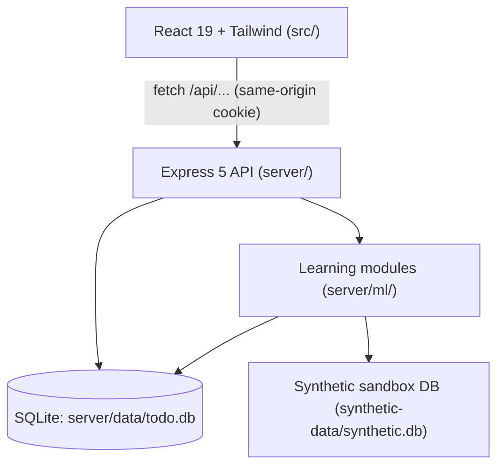
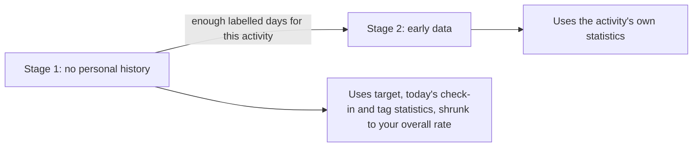
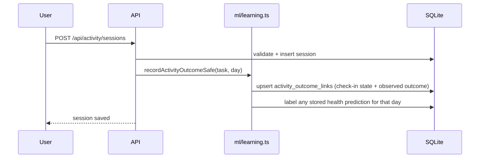
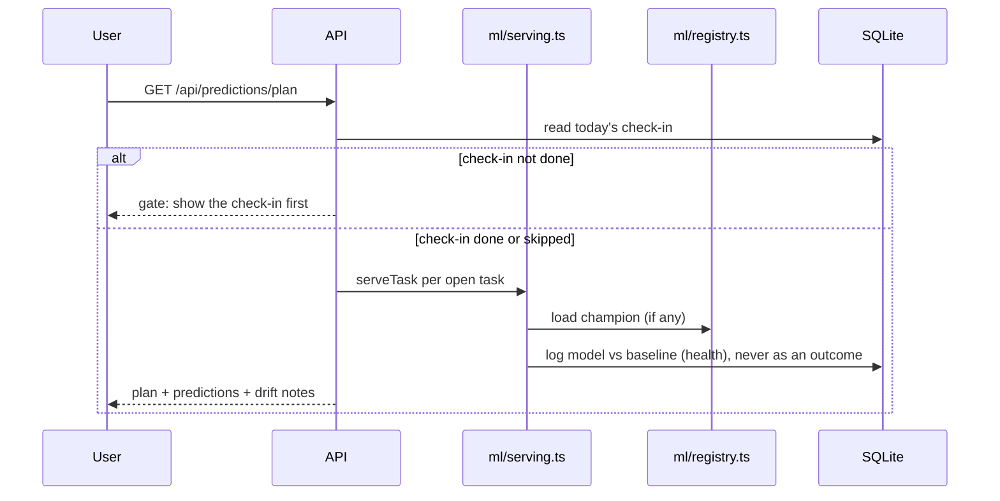

# Architecture

**Purpose.** How the web app and the local learning system fit together, layer by layer, and which module owns each job.

**Where in the code**

- `server/index.ts` — Express app, middleware and route mounting
- `server/db.ts` — the SQLite database and the app's core schema
- `server/ml/schema.ts` — the learning system's own tables
- `server/ml/*.ts` — the learning modules (collection, validation, features, training, evaluation, prediction, learning, health, drift, privacy, logging)
- `server/ml/routes.ts`, `prediction-routes.ts`, `state-routes.ts`, `off-day-routes.ts`, `health-routes.ts` — HTTP endpoints
- `src/App.tsx`, `src/api.ts`, `src/components/` — the React frontend
- `server/ml/synthetic/` — the isolated evaluation dataset and harness

## The three layers

- The **frontend** renders and sends mutations. It never computes a prediction and never writes an outcome.
- The **API** authenticates the session, validates input, and calls the learning modules.
- The **database** is a single local SQLite file. The learning system writes only its own tables plus the tables it owns in `server/ml/schema.ts`.
- The **synthetic sandbox** is a separate database file. It shares the code but never touches the app's data.

## The learning pipeline, as separate modules

Each job lives in its own file, so it can be tested and reasoned about alone.

| Job | Module(s) | What it does |
| --- | --- | --- |
| Data collection | `checkins-store.ts`, `ml/sessions.ts`, `ml/daily-activity.ts`, `ml/off-days.ts` | Stores the check-in, timed sessions, per-day statuses and off days |
| Validation | `ml/sessions.ts` (`validateSession`), `checkins-store.ts` (`parseAnswer`, `parseContext`, `parseLocalDate`), `ml/task-config.ts`, `ml/tags.ts` | Rejects invalid or overlapping input; never invents a value |
| Feature engineering | `ml/features.ts`, `ml/dataset.ts` | Builds the one feature vector used by both training and serving |
| Training | `ml/training.ts`, `ml/model/` (`logistic.ts`, `gbm.ts`, `quantile.ts`, `math.ts`), `ml/calibration.ts`, `ml/pipeline.ts` | Trains the candidate models and chooses one |
| Evaluation | `ml/metrics.ts`, `ml/synthetic/checks.ts`, `ml/synthetic/phase5-checks.ts`, `ml/synthetic/phase6-checks.ts` | Brier score, calibration, duration error, harness checks |
| Prediction (serving) | `ml/predictors.ts` (baseline), `ml/serving.ts` (champion), `ml/estimates.ts`, `ml/cold-start.ts` | Produces the numbers and the time window shown to the user |
| Continuous learning | `ml/learning.ts`, `ml/shadow.ts` | Links recorded activity to outcomes, gates and rate-limits retraining |
| Model versioning | `ml/registry.ts` | Append-only model rows, promotion, rollback, loading |
| Live health & drift | `ml/health.ts`, `ml/drift.ts` | Watches the served model and reports change |
| Privacy & logging | `ml/privacy.ts`, `ml/logging.ts` | Retention, deletion, local logs, graceful degradation |

## Cold start

The system never claims personalisation before it has the data.

The Stage 1 → Stage 2 threshold is per user (`stage2_min_days`, default 10 labelled days) and
is configurable in the prediction settings. Confidence is a separate axis and also drops when
the check-in was skipped or in the reduced-confidence window after an off day.

## Two request flows

**Recording activity (learning starts immediately).**

Retraining does **not** happen on every write. A scheduled or explicit trigger asks the
retrain gate whether enough new labelled data has accumulated, and a rate limit prevents
churn.

**Getting today's plan.**

## Failure handling

Every learning step can fail for an ordinary reason (a missing check-in, an unreadable
model payload). None of those may stop you recording what you did:

- `ml/logging.ts` (`safeRun`) runs a step and returns a documented fallback if it throws, logging the error instead of propagating it.
- `ml/serving.ts` falls back to the Phase 4 baseline when there is no champion, a payload cannot be read, a feature vector does not match, or the score is not a valid probability.
- `ml/health.ts` falls back to the baseline when the served model is worse than the baseline over the recent window.

## Related docs

- [data-model.md](data-model.md) — the tables
- [ml.md](ml.md) — features, algorithms, training, health, drift
- [predictions.md](predictions.md) — what is predicted and shown
- [operations.md](operations.md) — running, training and rollback
