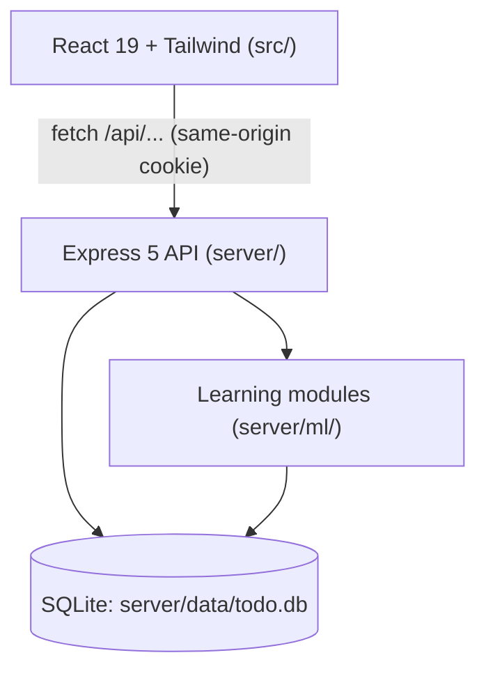
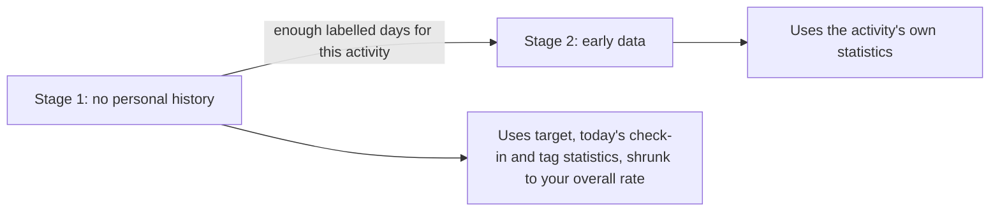
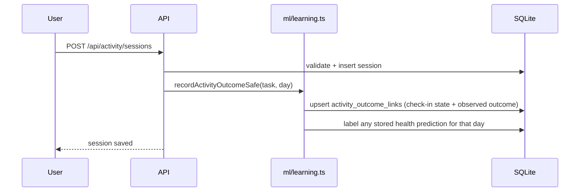
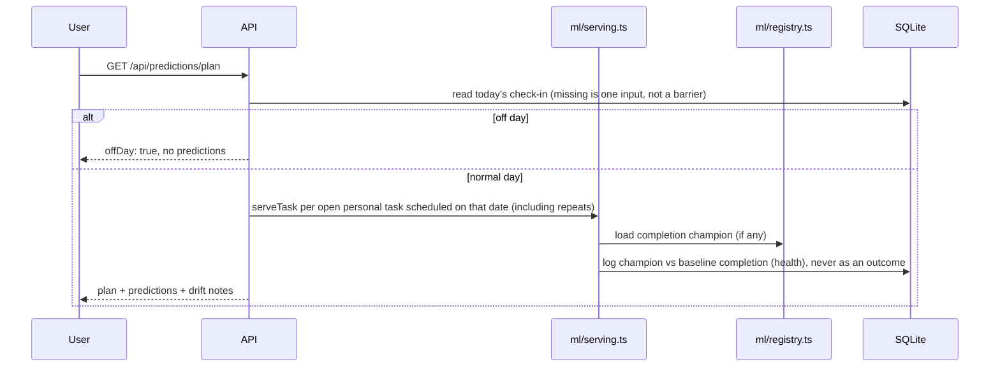

# Architecture

**Purpose.** How the web app and the local learning system fit together, layer by layer, and which module owns each job.

**Where in the code**

- `server/index.ts` — Express app, middleware and route mounting
- `server/db.ts` — the SQLite database and the app's core schema
- `server/ml/schema.ts` — the learning system's own tables
- `server/ml/*.ts` — the learning modules (collection, validation, completion features/training/evaluation, baseline prediction, learning, health, drift, logging)
- `server/ml/routes.ts`, `prediction-routes.ts`, `state-routes.ts`, `off-day-routes.ts`, `health-routes.ts` — HTTP endpoints
- `src/App.tsx`, `src/api.ts`, `src/components/`, `src/hooks/`, `src/lib/` — the React frontend (UI, state/orchestration hooks, and shared helpers)

## The three layers

- The **frontend** renders and sends mutations. It never computes a prediction and never writes an outcome. The header clock is a ticking state value, so it stays in sync with the system clock.
- The **API** authenticates the session, validates input, and calls the learning modules.
- The **database** is a single local SQLite file, currently 38 tables after the 2026-11-18 cleanup and the later reminder/skip-event tables described in [data-model.md](data-model.md). The learning system writes only its own tables plus the tables it owns in `server/ml/schema.ts`.

## Board controls

- The greeting row's date is a clickable calendar picker in both **My tasks** and **Teams**, with hover chevrons to step one day at a time. Both boards are scoped to the selected date, including the progress counter. A repeating task is projected onto each matching future date on either board and also stays in **Repeating**; completing it is one shared edit that rolls the single task forward to the next occurrence (same team, assignees and subtasks). Nudge uses the same projected occurrences and remains personal-only.
- Neither sidebar has a standalone calendar card. The **Off Day** card in My tasks and the **Off today** card in Teams each have a calendar button in the top right. It opens an off-day-toned modal with a small month calendar and a selected-date detail row. My tasks plots the signed-in user's off-day history, current period and future periods. Teams plots only teammates' periods in the selected team; the user's own off days stay in My tasks and are not repeated. The calendar pages across the earliest historical month through the latest future month; off dates are highlighted, with muted highlights for past ones. Selecting a date shows the matching period below the grid as `You are/were off` or `<teammate> is/was off`; no separate Upcoming/History lists are rendered.
- Both sidebars have an **Overdue tasks** card, in the same visual family as the Teams **Invitations** card. Its header is count-free and it no longer lists individual overdue tasks or offers inline **Open**, **Done** and **Move to today** actions. Instead it holds a single **View all overdue tasks** row with the overdue count for the current scope. Clicking it opens a modal with only past-due personal tasks, or only past-due tasks for the selected team, rendered as sticky notes; today's pending tasks are not included. Notes open task details, mark a task done, or send a reminder, but reordering stays on the dated board.
- Both sidebars also have a **Completed** card matching the Overdue card: a count-free header and one **View all completed tasks N Done** row. It opens a modal with the finished notes for the selected date in the current personal or team scope, rendered with the same sticky-note styling as Overdue (no reorder grip). Notes open task details, mark a task not done, or delete it; there is no **Similar** action in the completed list.
- The former inline **Repeating** column is now the same compact card + modal pair: **View all repeating tasks N Repeats** opens a scope-wide modal with every recurring note in the current personal or team list, whatever day it lands on. Notes use the same sticky-note styling as Completed/Overdue and keep their repeat badge; reordering stays on the dated board.
- Sidebar sections use distinct light cards — **Overdue** lavender, **Invitations** blush, **Repeating** powder blue, **Members** soft slate, **Off today** powder blue and **Completed** green — with matching tinted surfaces for their compact rows. None of these headers show numeric badges. The **Energy** card keeps its butter tone and uses light butter-tinted inner surfaces too. The Teams **Off today** card sits below **Members** and above **Invitations**. It uses the same powder-blue surface, border and inner box as the My tasks **Off Day** card. It reads the teammate off days already present in `bootstrap`, filters them to members of the selected team, excludes the signed-in user, and shows only periods covering today; historical and future teammate periods live in its header calendar. Each teammate row uses the same reason emoji as the My tasks **Off Day** card, and an empty card shows the same 🌤️ no-off-day emoji.
- Sending a reminder from an overdue sticky note creates an in-app record only — there is no email, push or webhook delivery. The three newest reminders for the current scope appear as compact rows in the Overdue card, above the **View all overdue tasks** row. A personal reminder has no recipient and reads “Reminder saved locally.” A team reminder goes to the task's current assignees; if nobody is assigned, it goes to every member of that team. Reminders are part of `bootstrap`, so they survive a refresh and disappear with their task.
- The **New task** title field shows autocomplete suggestions only after you start typing, drawn from previously created tasks in the selected list and ranked by frequency then recency. Choosing a suggestion only fills the field; it creates nothing by itself and does not call the prediction model.
- **Favourites** live in the dialog's side column. `src/lib/taskFavourites.ts` saves the current title, tags, priority, duration, repeat and list in this browser's local storage, one set per signed-in user. Applying a favourite fills only those fields; the due date stays the board's selected date. The three ML demo accounts also get four built-in favourites with stable ids and names; they are seeded into the same browser-local list on first read and never overwritten by a saved favourite with the same name. Entries saved under the old Templates key are migrated once. A closed dialog renders nothing, and corrupt storage is ignored.
- **Quick fill** is a separate button beside that field; hovering or focusing it shows a small popover with the `Try “Submit report tomorrow #work 30m”` example. `src/lib/quickAdd.ts` parses dates (`today`, `tomorrow`, `tonight`, weekdays, `next Monday`, `in N days/weeks`, ISO dates and slash dates such as `25/11/26`), durations, `#tags`, priority markers and a trailing team name matched against the dialog's team list. It then only updates the dialog's own state, including **Add to** when a team name is recognized. It does not change the autocomplete rules or call an API. Time words stay in the title, and there is no time-of-day input in the dialog.
- **Search tasks** sits in the greeting band between the greeting/date and the clock and opens only when clicked. It searches the already-loaded `bootstrap` payload — titles, tags, assignees, subtasks and comments — and filters by scope, status, priority, due date, tag and assignee. No sticky notes are shown until a term or non-default filter is set; **Clear search** resets the query and every filter. Once you type, `suggestSearchTitles` offers task titles from the selected Scope using the same tokenized matching, exact-match exclusion and frequency/recency ranking as New Task; choosing a suggestion only fills the field. Results reuse the same non-reorderable sticky notes; opening a result closes the dialog, while toggling or deleting keeps it open. No route, schema, stored data or prediction call is involved.

## Notification centre

- The bell beside the account name opens a header popover fed by `GET /api/notifications`. It groups pending team invitations, reminders addressed to the signed-in user, **Your moves**, and a recent **Team activity** feed into one panel. The feed includes task adds, completions, comments, assignments and team reminders from the user's teams, including the user's own actions. Rows show the team name when one exists in a neutral slate badge, and unread items use a soft indigo treatment. Invitations reuse the existing accept/decline actions; other rows open the linked task and then close the panel. The panel carries no delivery disclaimer.
- Your moves are derived from `task_skip_events` rows whose actor is the signed-in user and which are not undone. Off-day moves and skips both appear there with their from/to dates; only a recent skip (within `MOVE_UNDO_WINDOW_MS`) shows **Undo skip**. The same **Undo skip** button appears on a teammate's task-skip notice when the task is shared. Undo goes through `POST /api/tasks/:taskId/undo-skip`, which accepts the skipper or any member of the task's team, rechecks age and that the note is still open on the recorded destination, then restores the earlier date and local time. It records who undid the skip so `task-skip-undone` appears in every teammate's Team activity. A later manual move cannot be silently overwritten.
- The server only reads local rows: `team_invites`, `task_reminders` and their recipients, `comments`, `task_assignees`, `task_skip_events`, and task timestamps. Assignment metadata lives on `task_assignees` (`assigned_at`, `assigned_by`), backfilled from the task's creation time and owner and written by the assignee route. Completion metadata lives on `tasks` (`completed_at`, `completed_by`) and is set only when a task actually changes to done, so historical done rows stay blank because no completion time was recorded. `task_skip_events` is bookkeeping for visible moves, not a delivery queue; no email, push or webhook is added.
- Read state is a per-user timestamp in browser local storage. **Mark all read** updates only that local marker; the unread dot is derived from it. Everything stays in app — there is no email, push or webhook.

## Account controls

- **My Account → Tags** manages the user-scoped tags in the learning tables: add, rename and delete, each through the same modal with a styled confirm for deletion. Names are canonicalised to lower case at every entry point — the tag manager, the New Task and Task Detail inputs, presets, quick fill and the server's task/tag routes — so notes, chips and filters show one form. `createTag` is idempotent for an active name; `renameTag` rejects a collision instead of silently merging; `deleteTag` hides the row via `deleted_at`, clears current `task_tags` links and JSON labels, and detaches suggested context questions while keeping historic ids resolvable. `rewriteTaskTagNames` lower-cases every label on a task it touches. After each change the manager reloads its own list and refreshes bootstrap, so the board, detail view and search update immediately. Migration 16 folds legacy duplicate names *within one user* into the oldest active id; migration 17 adds `deleted_at` and lower-cases legacy names and labels. Identically named tags belonging to different users stay separate. No external service is involved.
- All modals portal to `document.body` while keeping the reference-counted scroll lock. That lets the Tag Manager and its confirm dialog sit above the My Account dialog as proper siblings instead of being clipped by an animated parent's transform. Static rendering tests fall back to in-place markup when `document` is unavailable.

## The learning pipeline, as separate modules

Each job lives in its own file, so it can be tested and reasoned about alone.

| Job | Module(s) | What it does |
| --- | --- | --- |
| Data collection | `checkins-store.ts`, `ml/sessions.ts`, `ml/daily-activity.ts`, `ml/off-days.ts` | Stores the check-in, timed sessions, per-day statuses and off days |
| Validation | `ml/sessions.ts` (`validateSession`), `checkins-store.ts` (`parseAnswer`, `parseContext`, `parseLocalDate`), `ml/task-config.ts`, `ml/tags.ts` | Rejects invalid or overlapping input; keeps valid values as given |
| Feature engineering | `ml/features.ts`, `ml/dataset.ts` | Builds the completion feature vector used by both training and serving |
| Training | `ml/training.ts`, `ml/model/` (`logistic.ts`, `gbm.ts`, `math.ts`), `ml/calibration.ts`, `ml/pipeline.ts` | Trains the completion candidates and chooses one |
| Evaluation | `ml/metrics.ts` | Brier score, ECE and ROC-AUC for completion |
| Prediction (serving) | `ml/predictors.ts` (baseline), `ml/serving.ts` (completion champion), `ml/estimates.ts`, `ml/cold-start.ts` | Produces the completion probability from a champion or baseline; target probability, expected duration and duration ranges stay baseline/statistical estimates. Nudge shows the completion probability (percentage beside the task, bar below); recommended time, target, duration and confidence stay computed and logged but are not displayed |
| Continuous learning | `ml/learning.ts`, `ml/shadow.ts` | Links recorded activity to outcomes and gates/rate-limits completion retraining; shadow helpers are retained and tested but are not invoked by the live promotion path |
| Model versioning | `ml/registry.ts` | Append-only completion model rows, promotion, rollback, loading |
| Live health & drift | `ml/health.ts`, `ml/drift.ts` | Watches the served completion model and reports change |
| Logging | `ml/logging.ts` | Local logs and graceful degradation |

## Cold start

The system never claims personalisation before it has the data.

The Stage 1 → Stage 2 threshold is per user (`stage2_min_days`, default 10 labelled days) and
is configurable in `user_settings`. Confidence is a separate axis and also drops when
the check-in was skipped or in the reduced-confidence window after an off day.

## Two request flows

**Recording activity (learning starts immediately).**

Retraining does **not** happen on every write. A scheduled or explicit trigger asks the
retrain gate whether enough new labelled data has accumulated, and a rate limit prevents
churn.

**Getting today's plan.**

## Failure handling

Every learning step can fail for an ordinary reason (a missing check-in, an unreadable
model payload). None of those may stop you recording what you did:

- `ml/logging.ts` (`safeRun`) runs a step and returns a documented fallback if it throws, logging the error instead of propagating it.
- `ml/serving.ts` falls back to the baseline completion estimate when there is no completion champion, a payload cannot be read, a feature vector does not match, or the score is not a valid probability. Target probability and expected duration are baseline estimates and need no fallback.
- `ml/health.ts` falls back to the baseline completion estimate when the served completion model is worse than the baseline over the recent window.

## Related docs

- [data-model.md](data-model.md) — the tables
- [ml.md](ml.md) — features, algorithms, training, health, drift
- [predictions.md](predictions.md) — what is predicted and shown
- [operations.md](operations.md) — running, training and rollback
