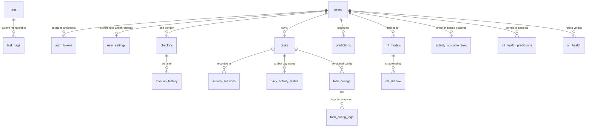

# Data model

**Purpose.** Every database table, what it holds, and the rules that keep a missing value missing and a prediction separate from an outcome.

**Where in the code**

- `server/db.ts` — the app's core tables (users, sessions, teams, tasks, …)
- `server/checkins-store.ts` — the check-in tables
- `server/ml/schema.ts` — the learning system's tables, in four groups: foundation, state, prediction, ML

## Storage

One SQLite file: `server/data/todo.db` (created on first boot, git-ignored). Foreign keys are
on. Every schema function is idempotent and safe to run on every boot, so starting the app
twice changes nothing.

The live database currently contains **32 tables**. Two cleanups were made on 2026-11-18:

1. An unused scaffold of nine planning/target/weekly tables was removed after a code search
   confirmed no module in `server/` or `src/` referenced them: `plan_blocks`,
   `plan_block_events`, `plan_blocked_windows`, `plan_free_windows`, `planning_settings`,
   `target_preferences`, `target_suggestions`, `weekly_reviews` and `weekly_review_dismissals`.
2. Two pairs of identically shaped tables were merged:
   `sessions` + `password_resets` → `auth_tokens(kind)`, and
   `state_prefs` + `prediction_settings` → `user_settings`.

The two pre-change snapshots were moved out of `server/data/` during the 2026-11-21
stale-file cleanup, so only the live `server/data/todo.db` remains in the project. No
check-in, task, prediction or ML table was removed, and the model code was left untouched.

## Table groups

### App core — `server/db.ts`

| Table | Holds |
| --- | --- |
| `users` | Account email and password hash |
| `auth_tokens` | Login sessions and password-reset codes in one table; `kind` distinguishes them. Only token **hashes** are stored |
| `teams`, `team_members`, `team_invites` | Teams, membership roles, pending invites |
| `tasks` | The task itself: text, done, due, position, progress, priority, tags, recurrence, duration, preferred time. `team_id NULL` means a personal task |
| `subtasks` | Subtasks with position, done and an optional assignee (a member of the task's team; `NULL` on personal tasks) |
| `comments` | Task comments |
| `task_assignees` | Team tasks assigned to several teammates. The task's `user_id` stays the creator/owner; any team member can edit this list |

### Check-ins — `server/checkins-store.ts`

| Table | Holds |
| --- | --- |
| `checkins` | One row per user per day: the nine answers (ordinals 1–5, `NULL` when blank), `skipped`, optional free-text `context` |
| `checkin_history` | An append-only snapshot on every edit, so a mid-day change keeps its timestamp |

### Foundation — `server/ml/schema.ts` (`createFoundationSchema`)

| Table | Holds |
| --- | --- |
| `tags` | Stable tag ids per user; `merged_into_id` points at the surviving tag |
| `tag_history` | Append-only trail of tag create / rename / merge |
| `task_tags` | Current task ↔ tag membership |
| `task_configs` | **Versioned** task configuration: name, category, priority, frequency, target duration, preferred time, active. A change appends a row; old rows are never overwritten |
| `task_config_tags` | The tag set as it stood for one config version |
| `activity_sessions` | Real timed activity: task, local date, start/end, duration, note, source. Several per day allowed |
| `daily_activity_status` | What you explicitly said about a day: `completed` / `partial` / `skipped` / `postponed`, with an optional reason |
| `context_questions` | Optional extra questions, attached to a task or suggested by a tag |
| `session_context` | Answers to extra questions, recorded against a session |
| `user_settings` | One user-keyed row for display preferences and prediction thresholds; both writers touch only their own columns |

### State layer — `createStateSchema`

| Table | Holds |
| --- | --- |
| `day_reviews` | The single optional evening review per day (one of five answers) |
| `state_suggestion_choices` | Whether a low-capacity suggestion was accepted or dismissed |

The display preferences used by this layer live in `user_settings` (foundation group).

### Prediction layer — `createPredictionSchema`

| Table | Holds |
| --- | --- |
| `off_days` | One row per off period: kind (optional), start, end, note |
| `predictions` | The prediction **log**: source (baseline / model), model version, check-in state, probabilities, durations, recommended window, confidence, stage, explanation. Written by the server only |
| `prediction_feedback` | Whether a suggestion was shown, exploratory, and followed — stored apart from both predictions and outcomes |

The configurable thresholds (reduced-confidence days, exploration share, stage-2 minimum) live
in `user_settings` (foundation group).

### ML and continuous learning — `createMlSchema`

| Table | Holds |
| --- | --- |
| `ml_models` | One append-only row per trained version: kind, version, status (`candidate` / `champion` / `retired` / `rejected`), data range, counts, feature names, hyperparameters, seed, metrics, git commit, serialised payload |
| `ml_shadow` | A candidate's silent predictions beside the champion's on live days; `label` stays `NULL` until the day is labelled |
| `ml_retrain_state` | Labelled-observation count at the last training, per kind |
| `activity_outcome_links` | One row per (user, task, day): the check-in state that preceded the day, the observed outcome (`performed`, `target_achieved`, `total_minutes`), the tags and priority that applied, and the config version. Recomputed when activity is recorded |
| `ml_health_predictions` | A served model's output beside the baseline's for the same (kind, day, task). `label` is `NULL` until the day's outcome is known |
| `ml_health` | The rolling verdict per (user, kind): Brier/calibration/error for model and baseline, the `fallback` flag and a plain-words reason |
| `ml_retrain_log` | Append-only trail of retrain attempts, used for the rate limit and the health view |

## Relationships (simplified)

## Rules the schema enforces

- **Missing stays missing.** A blank check-in answer is `NULL`, never a neutral value. "No priority" is `NULL`, never `low`. A skipped check-in stores no answers at all.
- **`not_asked` vs skipped.** There is no row at all for a day you never touched; an explicit skip writes a row with `skipped = 1`. The two are different facts.
- **History is kept.** Tags and task configuration are versioned and append-only. Renaming or merging a tag never breaks a past record.
- **A prediction is never an outcome.** Predictions live in `predictions`, `ml_shadow`, `ml_health_predictions`. Outcomes live in `activity_sessions`, `daily_activity_status`, `activity_outcome_links`. The label columns in the ML tables are filled only from observed activity.

## Related docs

- [architecture.md](architecture.md) — how the layers use these tables
- [checkin-and-energy.md](checkin-and-energy.md) — the check-in tables in use
- [predictions.md](predictions.md) — the prediction log and feedback
- [privacy-and-limits.md](privacy-and-limits.md) — retention and deletion
