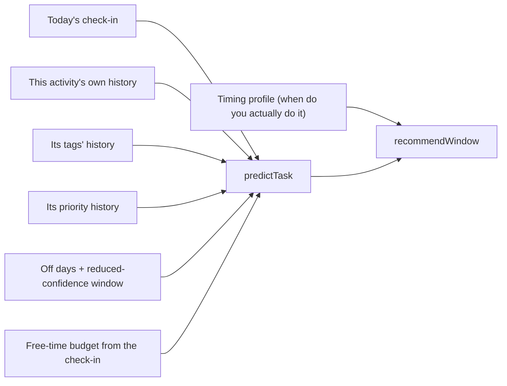

# Predictions

**Purpose.** What the app predicts, which inputs feed each number, how the prediction is served and shown, and how the log keeps predictions apart from outcomes.

**Where in the code**

- `server/ml/predictors.ts` — the baseline prediction, the time window, the plan and its ranking
- `server/ml/serving.ts` — the champion model on top of the baseline
- `server/ml/live-predictor.ts` — the entry point the routes call (champion, or baseline fallback)
- `server/ml/cold-start.ts` — the two stages and confidence
- `server/ml/off-days.ts` — off days and the reduced-confidence window
- `server/ml/estimates.ts` — the display estimates and their validation
- `server/ml/predictions.ts` — the prediction log and feedback
- `server/ml/prediction-routes.ts` — the `/api/predictions` routes
- `src/components/PredictionPanel.tsx` — the on-screen card

## What is predicted

| Number | Meaning | Absent when |
| --- | --- | --- |
| Completion probability | How likely you are to do the task on that day | Never (always a number) |
| Target probability | How likely you are to reach the day's target | The task has no target duration |
| Expected duration | How long it usually takes, with a low–high range | Not enough duration history |
| Recommended window | A suggested start–end time | No timing history yet |
| Confidence | low / medium / high | Never |
| Stage | 1 (starting estimate) or 2 (personalised) | Never |

Everything is a **suggestion**. A preferred time, where one is set, is an initial hint
only — never a deadline.

## Inputs, per prediction

- **Own history** — completion rate, recent rate, a recency-decayed rate, consistency, days since last completion, recent misses, weekday rate, target rate, duration mean/median/trend.
- **Tags** — the weighted completion rate and duration of the task's tags, shrunk toward your overall rate. Tag history is used, never invented.
- **Priority** — the priority that applied **on that day** (from the versioned config), shrunk toward your overall rate.
- **Check-in** — a small, bounded adjustment from the answered fields, plus the free-time budget.
- **Off days** — excluded from statistics; after an off period, confidence is reduced for a configurable number of days.
- **Today's progress** — minutes already recorded today, counted only up to the prediction time.

## Cold start and confidence

Two stages, with a per-user threshold (`stage2_min_days`, default 10 labelled days):

- **Stage 1** — no personal history for the activity. The prediction comes from the target, the day's check-in and the tag statistics, shrunk to your overall rate, and is labelled *insufficient personal history*. Confidence is never above low.
- **Stage 2** — the activity's own statistics drive the prediction.

Confidence drops when the check-in was skipped (wider uncertainty, never an invented value)
and in the reduced-confidence window after an off day.

## Baseline vs model

- The **baseline** (`predictors.ts`) always works and always has an answer. Its version string is `baseline-1.0.0`.
- A **champion model** (`serving.ts`) replaces the completion, target and duration numbers when one is registered, loadable and healthy. The recommended window and the explanation still come from the baseline, so timing is unchanged.
- If there is no champion, the payload cannot be read, the feature vector does not match, the score is invalid, or the live health check has fallen back, the baseline is served and the reason is stated.
- One entry point, `server/ml/live-predictor.ts`, is used by **both** `/api/predictions/plan` and `/api/predictions/task`, so the plan and the single-task view cannot disagree. With no champion in the database both show the baseline, exactly as before.
- `ML_DISABLE_MODEL_SERVING=1` keeps baseline-only behaviour on both routes without changing any model data (read at startup).

See [ml.md](ml.md) for how a champion is trained, promoted and watched.

## Plan, gating and off days

- `GET /api/predictions/plan` is gated on today's check-in. Until it is completed or skipped, the response says `gate: true` and shows no numbers.
- An off day returns `offDay: true` with **no** predictions at all.
- The plan ranks today's open tasks by probability, priority, what is left of the target and how much time is left. The ranking is a suggestion; it never changes a probability.
- Low-confidence, low-priority, sufficiently-labelled tasks may get optional reschedule/drop suggestions. They are offered, never forced.
- Plain-language **drift notes** (a recent-vs-long-term shift, or a dated configuration change) are added next to the plan. They are informational and never change a number.

## The prediction log

The server — never the client — writes each prediction to the `predictions` table, separate
from outcomes. The log stores the source, model version, check-in state, the numbers, the
window, confidence, stage, an explanation and the raw inputs.

`prediction_feedback` records whether a suggestion was shown, whether it was exploratory and
whether you followed it — stored apart from both the predictions and the outcomes. A
prediction is **never** written back as an outcome.

## Related docs

- [checkin-and-energy.md](checkin-and-energy.md) — the check-in that gates the plan
- [ml.md](ml.md) — training, promotion, health and drift
- [data-model.md](data-model.md) — the `predictions` and `prediction_feedback` tables
- [decisions.md](decisions.md) — why the preferred time is only a hint
