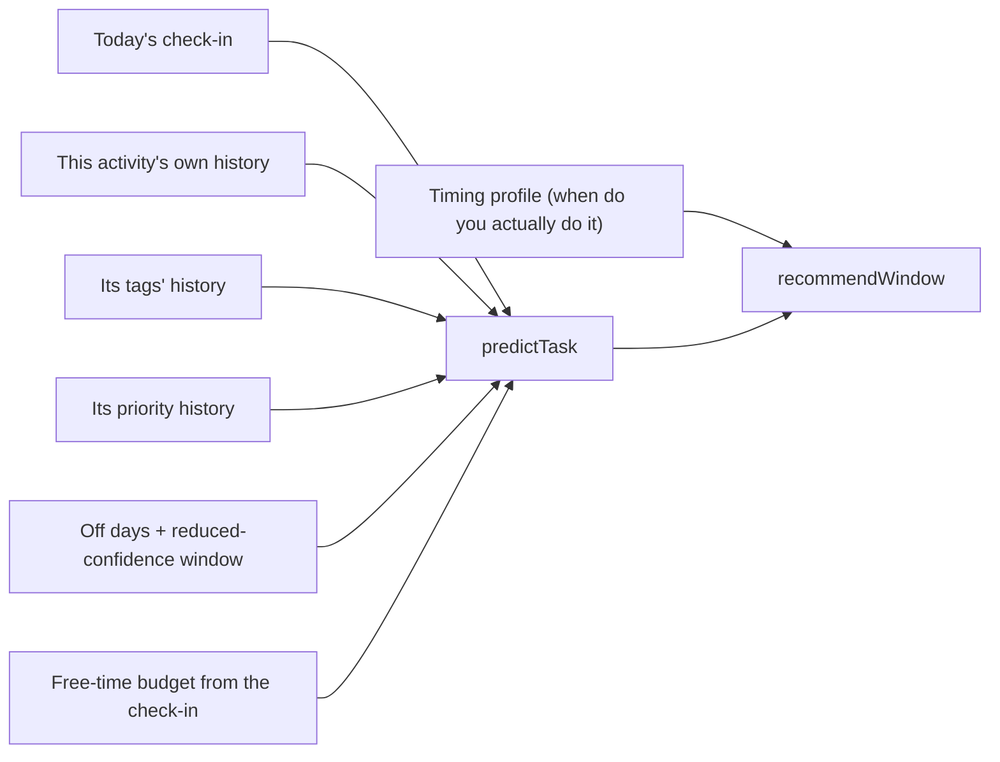

# Predictions

**Purpose.** What the app predicts, which inputs feed each number, how the prediction is served and shown, and how the log keeps predictions apart from outcomes.

**Where in the code**

- `server/ml/predictors.ts` — the baseline prediction, the time window, the plan and its ranking
- `server/ml/serving.ts` — the completion champion on top of the baseline
- `server/ml/live-predictor.ts` — the entry point the routes call (completion champion, or baseline fallback)
- `server/ml/cold-start.ts` — the two stages and confidence
- `server/ml/off-days.ts` — off days and the reduced-confidence window
- `server/ml/estimates.ts` — baseline target probability, expected duration and display estimates
- `server/ml/predictions.ts` — the prediction log and feedback
- `server/ml/day-planner.ts` — the proposed flow and workload warning (still computed by the API, no longer shown in the UI)
- `server/ml/reschedule.ts` — display-only ideas for tasks that could move to another day (still computed by the API, no longer shown in the UI)
- `server/ml/prediction-routes.ts` — the `/api/predictions` routes
- `src/components/PredictionPanel.tsx` — the on-screen card

## What is predicted

| Number | Shown as | Meaning | Absent when |
| --- | --- | --- | --- |
| Completion probability | Nudge: "Chance you'll work on it today" subtitle, then task name + percentage with a bar below | How likely you are to do some work on the task that day; any logged activity counts, even a short session. Served by the completion champion when healthy, otherwise by the baseline | Never (always a number) |
| Target probability | Not shown in the current UI; baseline estimate only | How likely you are to reach the task's full time target, from statistical history | The task has no target duration |
| Expected duration | Not shown in the current UI; baseline estimate only | Roughly how long it usually takes, from recorded duration history | Not enough duration history |
| Confidence | Not shown in the current UI | How much personal history backs the completion number | Never |
| Stage | not shown | 1 (starting estimate) or 2 (personalised) | Never |

The recommended window, proposed flow, workload warning, "better days" ideas, target probability
and expected duration are still computed, logged and returned by the API, but Nudge does not
display them. Only completion has a trained model; the other numbers are baseline/statistical
estimates used for display, scheduling and plan ranking.

## What Nudge displays

The card is headed **Nudge** with the subtitle **Chance you'll work on it today** underneath and a
sparkle button that opens a hover/focus tooltip explaining the estimate. For each open personal
task scheduled on the selected date — due that day or a repeating occurrence projected onto it —
it shows the task name, the completion probability as a percentage beside it, and a bar underneath.
It does not show a recommended time, confidence label, target probability, estimated duration or
progress wording.
Low-chance, low-priority tasks may also show **Worth a look** suggestions with *Drop it / Move it*
and *Keep it* actions. Nudge needs no check-in: today's tasks show a percentage straight away.
When a check-in *is* answered, those answers feed the predictor and Nudge refreshes with the
updated value; no answer simply means that input is missing. Only the off-day message still
appears when relevant. Nudge appears only on the My tasks board — Task Detail has no Nudge
section.

Everything is a **suggestion**.

## Inputs, per prediction

- **Own history** — completion rate, recent rate, a recency-decayed rate, consistency, days since last completion, recent misses, weekday rate, target rate, duration mean/median/trend.
- **Tags** — the weighted completion rate and duration of the task's tags, shrunk toward your overall rate. Tag history is used as recorded.
- **Priority** — the priority that applied **on that day** (from the versioned config), shrunk toward your overall rate.
- **Check-in** — a small, bounded adjustment from the answered fields, plus the free-time budget.
- **Off days** — excluded from statistics; after an off period, confidence is reduced for a configurable number of days.
- **Today's progress** — minutes already recorded today, counted only up to the prediction time.

## Cold start and confidence

Two stages, with a per-user threshold (`stage2_min_days`, default 10 labelled days):

- **Stage 1** — no personal history for the activity. The prediction comes from the target, the day's check-in and the tag statistics, shrunk to your overall rate, and is labelled *insufficient personal history*. Confidence is never above low.
- **Stage 2** — the activity's own statistics drive the prediction.

Confidence drops when the check-in was skipped (the uncertainty stays wider)
and in the reduced-confidence window after an off day. The Nudge card no longer prints a
sentence about the skip; the uncertainty is still part of the prediction.

## Baseline estimates vs the completion champion

- The **baseline** (`predictors.ts`, `estimates.ts`) always works and always has an answer. Its version string is `baseline-1.0.0`. It supplies target probability, expected duration and the recommended window (from the timing profile), as well as the completion fallback.
- The **completion champion** (`serving.ts`) replaces only the completion probability when it is registered, loadable and healthy. Target probability and expected duration stay baseline/statistical estimates; the explanation also comes from the baseline. The window is logged but is not shown in Nudge.
- If there is no completion champion, the payload cannot be read, the feature vector does not match, the score is invalid, or completion health has fallen back, the baseline completion estimate is served and the reason is stated.
- One entry point, `server/ml/live-predictor.ts`, is used by **both** `/api/predictions/plan` and `/api/predictions/task`, so the plan and the single-task view cannot disagree. With no completion champion in the database both show baseline estimates, exactly as before.
- `ML_DISABLE_MODEL_SERVING=1` keeps baseline-only behaviour on both routes without changing any model data (read at startup).

See [ml.md](ml.md) for how the completion champion is trained, promoted and watched.

## Plan and off days

- `GET /api/predictions/plan` always returns a plan for the requested date. An unanswered check-in is just one missing input; the response stays `gate: false` and shows numbers straight away.
- Predictions are **personal tasks only**. Team tasks are never predicted, never appear in Nudge, and never feed the history, statistics or training data behind a prediction. The single-task and statistics endpoints also refuse team tasks and other users' tasks.
- An off day returns `offDay: true` with **no** predictions at all. The dated board hides repeating personal occurrences for the whole off span and moves open personal tasks actually due on those dates to the next non-off date; no duplicate repeat is created on that next day. Team tasks keep their shared due date and teammates receive an off-day notice instead. Clearing or editing the off day returns moved personal tasks to their original date when it is no longer off.
- **Skip for today** moves any open note scheduled for that date to the next non-off date, so the same note appears once on the new date in the board and Nudge. It does not mark the note done or create a duplicate occurrence; skipping a team note creates an in-app notice for teammates, who can undo it within a week, and the undo is visible to the whole team.
- The plan only considers open **personal** tasks scheduled on the requested date: tasks due that day and repeating tasks whose next occurrence falls on that date. Team tasks, tasks due on other dates and tasks with no due date are never part of it. It ranks them by probability, priority, what is left of the target and how much time is left. The ranking is a suggestion; it never changes a probability.
- The same `/plan` response also carries `schedule` (a proposed flow and workload warning) and `reschedules` (ideas for another day). Both are still computed as **display-only** data — nothing is written to a task's date — but the current UI does not show them. An off day suppresses both.
- Low-confidence, low-priority, sufficiently-labelled tasks may still produce **Worth a look** suggestions. They are offered as ideas, never forced.
- Plain-language **drift notes** (a recent-vs-long-term shift, or a dated configuration change) are returned with the plan. They are informational, never change a number, and are not displayed in the current Nudge card.

## The prediction log

The server — never the client — writes each prediction to the `predictions` table, separate
from outcomes. The log stores the source, model version, check-in state, the numbers, the
window, confidence, stage, an explanation and the raw inputs.

`prediction_feedback` records whether a suggestion was shown, whether it was exploratory and
whether you followed it — stored apart from both the predictions and the outcomes. A
prediction is **never** written back as an outcome.

## Related docs

- [checkin-and-energy.md](checkin-and-energy.md) — the check-in and how it feeds predictions
- [ml.md](ml.md) — training, promotion, health and drift
- [data-model.md](data-model.md) — the `predictions` and `prediction_feedback` tables
- [decisions.md](decisions.md) — training, promotion, health and drift decisions
